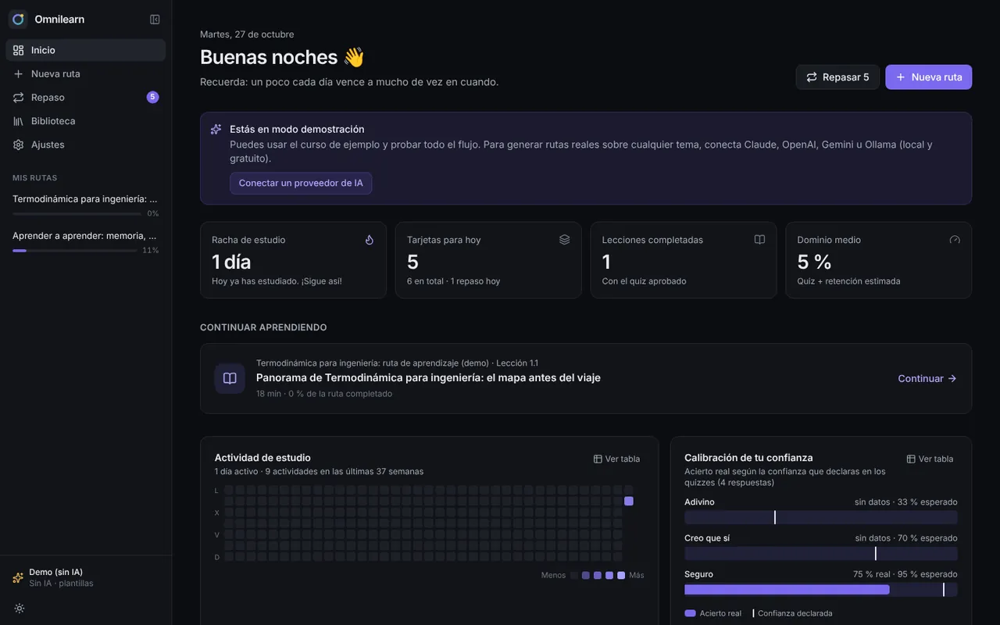
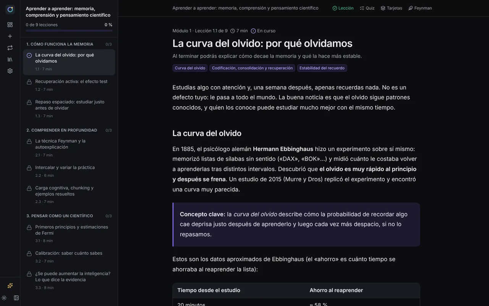
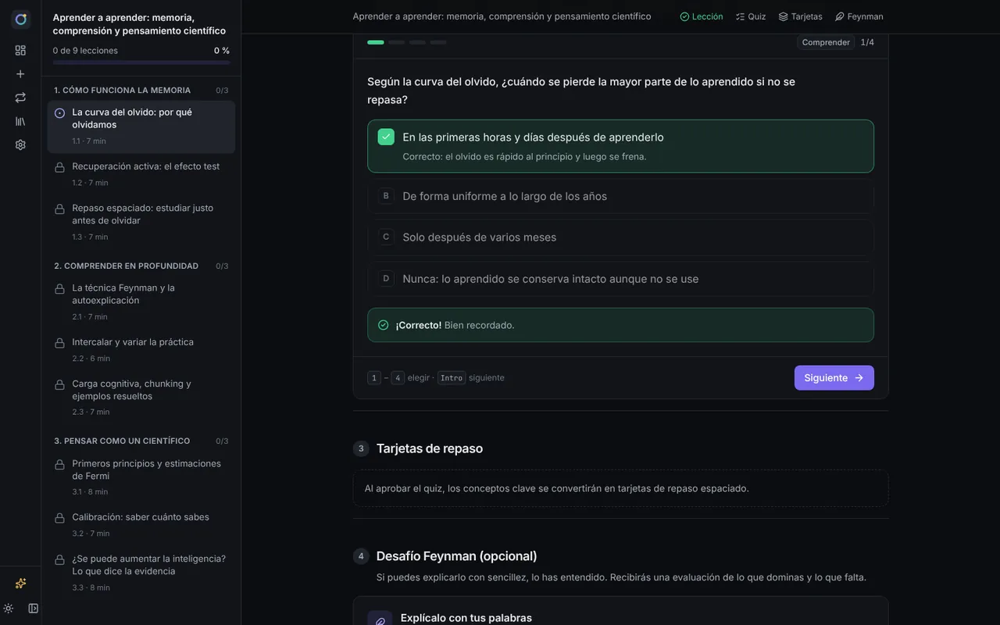
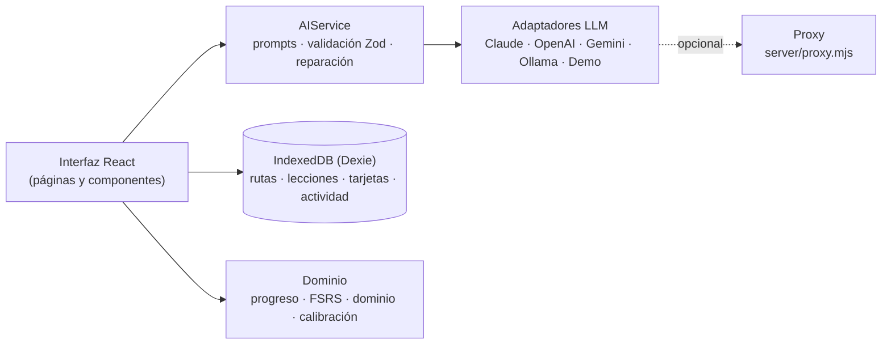

# Omnilearn

**Aprende cualquier tema con rutas de aprendizaje adaptativas, recuperación activa y repaso espaciado.**
Escribe lo que quieres aprender («Física cuántica», «Optimización de consultas SQL», «Historia de Roma»…) y Omnilearn diseña una ruta a tu medida, redacta cada lección cuando la abres, comprueba que la has entendido y se encarga de que no la olvides.



Omnilearn no es un chat de preguntas y respuestas. Es un generador de rutas de estudio que aplica tres principios:

1. **Andamiaje cognitivo:** cada tema se desglosa en _Ruta → Módulos → Lecciones → Conceptos clave_, ordenados por prerrequisitos.
2. **Adaptabilidad:** lenguaje, profundidad y analogías cambian según tu nivel (desde cero tipo Feynman, práctico o técnico), tu enfoque y tu tiempo.
3. **Aprendizaje activo:** ninguna lección se completa solo leyendo; hay que superar un micro-quiz, y lo aprendido pasa a tarjetas de repaso espaciado.

Funciona **sin backend** (todo se guarda en tu navegador) y con **el motor de IA que prefieras**: Claude, OpenAI y compatibles, Gemini u Ollama (local y gratuito). Incluye un **modo demo** y un **curso de ejemplo** («Aprender a aprender») para probarlo sin ninguna clave.

## Qué incluye

| Área                       | Funciones                                                                                                                                                                                                                                                                                                                                                                                            |
| -------------------------- | ---------------------------------------------------------------------------------------------------------------------------------------------------------------------------------------------------------------------------------------------------------------------------------------------------------------------------------------------------------------------------------------------------- |
| **Generador de rutas**     | Tema libre · nivel (desde cero / básico / intermedio / avanzado) · enfoque (teórico / práctico / examen / resumen ejecutivo) · tiempo (micro-lecciones o sesiones profundas) · objetivo personal · material propio (pega tu temario o apuntes) · vista previa del mapa de ruta en JSON estructurado antes de empezar                                                                                 |
| **Entorno de estudio**     | Árbol de módulos y lecciones con estados (bloqueada, disponible, en curso, completada) y barra de progreso · Markdown enriquecido con código resaltado, tablas, fórmulas LaTeX y diagramas Mermaid · lecciones generadas en _streaming_ y adaptadas a tus fallos anteriores                                                                                                                          |
| **Acciones rápidas**       | «Más simple (analogía)», «Ejemplo práctico», «Profundizar» y «Preguntar al tutor», sobre toda la lección o **sobre el fragmento que selecciones**                                                                                                                                                                                                                                                    |
| **Evaluación y retención** | Micro-quiz de 3-5 preguntas con retroalimentación por opción y niveles de Bloom · confianza declarada en cada respuesta (entrena la calibración) · aprendizaje por dominio (la siguiente lección se desbloquea al aprobar) · tarjetas automáticas · los errores del quiz se convierten en tarjetas · repaso espaciado con **FSRS** (el algoritmo de Anki) · **Desafío Feynman** evaluado con rúbrica |
| **Panel**                  | Rutas activas, finalizadas y archivadas · racha · tarjetas pendientes · lecciones completadas · dominio por ruta · mapa de calor de actividad · gráfico de calibración                                                                                                                                                                                                                               |
| **Biblioteca**             | Buscador (sin importar acentos) y filtros de conceptos aprendidos y tarjetas; crear, editar, suspender y borrar tarjetas                                                                                                                                                                                                                                                                             |
| **Datos**                  | Local-first (IndexedDB) · exportar e importar JSON (copia completa, una ruta o un temario suelto con el contrato del motor)                                                                                                                                                                                                                                                                          |
| **Interfaz**               | Minimalista (estilo Notion/Linear), modo oscuro por defecto y modo claro, ancho de lectura de ~68 caracteres, tipografía sans o serif, adaptable a móvil, atajos de teclado                                                                                                                                                                                                                          |

<p>
  
  
</p>

## Inicio rápido

Requisitos: Node.js 22.12 o superior.

```bash
npm install
npm run dev        # abre http://localhost:5173
```

La app arranca en **modo demo** con el curso de ejemplo instalado. Para generar rutas reales sobre cualquier tema, ve a **Ajustes → Motor de IA**.

## Conectar un motor de IA

| Proveedor                | Qué necesitas                                                             | Modelo por defecto | Notas                                                                                                                                  |
| ------------------------ | ------------------------------------------------------------------------- | ------------------ | -------------------------------------------------------------------------------------------------------------------------------------- |
| **Claude (Anthropic)**   | Clave de [platform.claude.com](https://platform.claude.com/settings/keys) | `claude-opus-5-5`  | SDK oficial con salida estructurada (JSON Schema). `claude-sonnet-5-5` y `claude-haiku-5-5` son más rápidos y baratos.                 |
| **OpenAI y compatibles** | Clave del proveedor                                                       | `gpt-5-mini`       | Cambia la URL base para OpenRouter (`https://openrouter.ai/api/v1`), Groq, DeepSeek, Mistral o LM Studio (`http://localhost:1234/v1`). |
| **Gemini (Google)**      | Clave de [AI Studio](https://aistudio.google.com/apikey)                  | `gemini-3.6-flash` | Usa `responseJsonSchema`.                                                                                                              |
| **Ollama (local)**       | [Ollama](https://ollama.com) + un modelo (`ollama pull qwen3:8b`)         | `qwen3:8b`         | Gratis y privado. Si sirves la app desde un dominio que no sea `localhost`, arranca Ollama con `OLLAMA_ORIGINS=https://tu-dominio`.    |
| **Demo**                 | Nada                                                                      | —                  | Plantillas sin IA: guías de estudio genéricas para cualquier tema.                                                                     |

Pulsa **«Cargar modelos»** para ver los modelos disponibles con tu clave y **«Probar conexión»** para verificarla.

> **Privacidad:** las claves se guardan solo en tu navegador (localStorage) y se envían únicamente al proveedor elegido. Para que otras personas usen la app sin ver tus claves, usa el proxy.

## Compartir sin exponer claves: el proxy

`server/proxy.mjs` (Node, sin dependencias) guarda las claves en el servidor, solo reenvía los endpoints que usa Omnilearn, limita peticiones por IP y, opcionalmente, exige un código de acceso. Además sirve la app compilada en el mismo origen:

```bash
npm run build
ANTHROPIC_API_KEY=sk-ant-… PROXY_TOKEN=codigo-de-clase npm run proxy
# → http://localhost:8787
```

En **Ajustes → Opciones avanzadas**, pon como URL base `http://localhost:8787/anthropic` (o `/openai`, o `/gemini/v1beta`) y escribe el `PROXY_TOKEN` en el campo de la clave.

| Variable                                       | Uso                                                                                      |
| ---------------------------------------------- | ---------------------------------------------------------------------------------------- |
| `OPENAI_API_KEY`, `OPENAI_BASE_URL`            | Clave y URL de cualquier API compatible con OpenAI                                       |
| `ANTHROPIC_API_KEY`                            | Clave de Claude                                                                          |
| `GEMINI_API_KEY`                               | Clave de Gemini                                                                          |
| `PROXY_TOKEN`                                  | Código de acceso opcional (se escribe en el campo «Clave de API»)                        |
| `ALLOWED_ORIGINS`                              | Orígenes permitidos por CORS (por defecto `http://localhost:5173,http://localhost:4173`) |
| `RATE_LIMIT_PER_MIN`, `MAX_BODY_BYTES`, `PORT` | Límite por IP (60), tamaño máximo (2 MB), puerto (8787)                                  |

## Scripts

| Comando                             | Qué hace                                                                                           |
| ----------------------------------- | -------------------------------------------------------------------------------------------------- |
| `npm run dev`                       | Servidor de desarrollo                                                                             |
| `npm run build` / `npm run preview` | Build de producción y vista previa                                                                 |
| `npm run check`                     | Tipos + lint + pruebas unitarias                                                                   |
| `npm test`                          | Pruebas unitarias y de integración (Vitest)                                                        |
| `npm run test:e2e`                  | Pruebas de extremo a extremo en navegador (Playwright; la primera vez: `npm run test:e2e:install`) |
| `npm run proxy`                     | Proxy opcional con claves en el servidor                                                           |
| `npm run format`                    | Formatea con Prettier                                                                              |

## Arquitectura en 30 segundos



- Cada llamada estructurada del `AIService` devuelve datos que cumplen el contrato o lanza un error tipado: el LLM recibe un **JSON Schema estricto**, la respuesta se valida con **Zod** y, si falla, se le devuelven los errores concretos para que la corrija.
- Las lecciones se redactan **justo a tiempo** (al abrirlas) y se adaptan a los conceptos que fallaste en lecciones anteriores.

Más detalle en [docs/ARQUITECTURA.md](docs/ARQUITECTURA.md).

## Estructura

```
src/
  ai/            AIService, prompts pedagógicos, adaptadores de proveedores, normalización
  domain/        Esquemas (contrato de datos), progreso, FSRS, métricas
  db/            IndexedDB (Dexie), repositorios, copias de seguridad, curso de ejemplo
  data/sample/   Curso de ejemplo «Aprender a aprender» (contenido real)
  components/    UI (primitivas, Markdown, lección, panel…)
  pages/         Panel, nueva ruta, ruta, lección, repaso, biblioteca, ajustes
server/          Proxy opcional
e2e/             Pruebas de Playwright (incluye un LLM falso para probar los adaptadores reales)
docs/            Arquitectura, motor pedagógico, contrato de datos, viabilidad y hoja de ruta
```

## Despliegue

Es una SPA estática con `HashRouter` y rutas relativas: el contenido de `dist/` funciona en cualquier hosting estático.

- **GitHub Pages:** activa Pages con «GitHub Actions» como origen y ejecuta el workflow _Publicar en GitHub Pages_.
- **Netlify / Vercel / Cloudflare Pages:** comando `npm run build`, carpeta `dist`.
- **Con el proxy:** cualquier servidor con Node 22 (Render, Railway, Fly.io, un VPS…): `npm run build && npm run proxy`.

## Documentación

- [Arquitectura](docs/ARQUITECTURA.md): decisiones técnicas, flujo de generación, cómo añadir un proveedor.
- [Motor pedagógico](docs/MOTOR_PEDAGOGICO.md): técnicas basadas en evidencia y cómo se aplican.
- [Contrato de datos](docs/CONTRATO_DE_DATOS.md): estructuras JSON del motor, exportación e importación.
- [Viabilidad y hoja de ruta](docs/VIABILIDAD_Y_ROADMAP.md): propuestas para que funcione de verdad, costes, métricas y siguientes pasos.

## Licencia

Aún sin definir. Elige una (por ejemplo MIT) antes de publicar el código.
