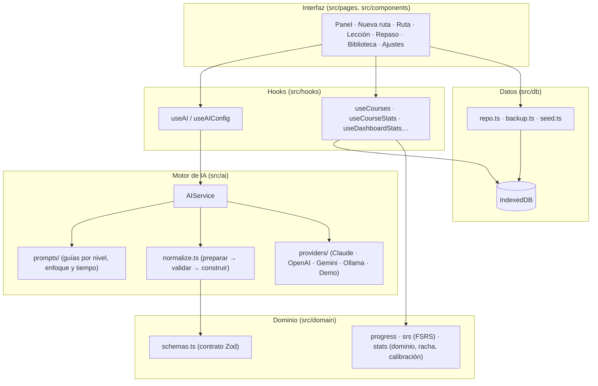

# Arquitectura de Omnilearn

## 1. Decisiones principales

| Decisión           | Elección                                                               | Por qué                                                                                                                                       |
| ------------------ | ---------------------------------------------------------------------- | --------------------------------------------------------------------------------------------------------------------------------------------- |
| Tipo de aplicación | SPA **local-first** (sin backend obligatorio)                          | Funciona al instante, se aloja gratis en cualquier hosting estático, los datos son del usuario y no hay servidores que mantener para empezar. |
| Frontend           | React 19 + TypeScript (estricto) + Vite 8                              | Ecosistema maduro, tipos de extremo a extremo y builds rápidos con _code splitting_ por página.                                               |
| Estilos            | Tailwind CSS 4 + tokens en variables CSS                               | Tema oscuro/claro cambiando solo variables; utilidades semánticas (`bg-surface`, `text-fg-muted`).                                            |
| Persistencia       | IndexedDB con Dexie + exportación/importación JSON                     | Capacidad de sobra para cientos de rutas, consultas reactivas (`useLiveQuery`) e índices (p. ej. tarjetas por fecha de repaso).               |
| Estado de ajustes  | Zustand con persistencia en `localStorage`                             | Simple; el `index.html` lee el tema antes de pintar (sin destellos).                                                                          |
| Rutas              | React Router 8 con `HashRouter`                                        | Funciona en GitHub Pages y similares sin reglas de reescritura.                                                                               |
| Contrato de datos  | **Zod 4** como única fuente de verdad                                  | De un mismo esquema salen los tipos TypeScript, el JSON Schema estricto que se envía al LLM y la validación de su respuesta.                  |
| Repaso espaciado   | **FSRS** (`ts-fsrs`)                                                   | El algoritmo moderno de Anki: menos repasos para la misma retención que SM-2.                                                                 |
| Markdown           | `react-markdown` + GFM + KaTeX + highlight.js + Mermaid (bajo demanda) | Lecciones técnicas con tablas, fórmulas, código y diagramas, sin interpretar HTML del modelo.                                                 |
| IA                 | `AIService` + adaptadores intercambiables                              | Cambiar de proveedor no toca la lógica pedagógica; añadir uno es implementar una interfaz de 2 métodos.                                       |
| Claude             | SDK oficial `@anthropic-ai/sdk`, cargado bajo demanda                  | Salida estructurada nativa, tipos y manejo de errores del SDK, sin penalizar el bundle inicial.                                               |
| Pruebas            | Vitest (unitarias/integración) + Playwright (e2e)                      | Lógica, adaptadores, proxy y flujos reales en navegador.                                                                                      |

## 2. Capas



Reglas de dependencia: el dominio no conoce React ni la base de datos; los adaptadores no conocen la pedagogía; la interfaz nunca toca tablas directamente (usa `repo.ts`).

## 3. Flujo de generación

```mermaid
sequenceDiagram
  participant U as Usuario
  participant UI as Nueva ruta
  participant S as AIService
  participant P as Proveedor LLM
  participant DB as IndexedDB
  U->>UI: tema, nivel, enfoque, tiempo, objetivo, material
  UI->>S: generateSyllabus(input)
  S->>S: buildSyllabusMessages(input)
  S->>P: generateJSON(mensajes, JSON Schema estricto)
  P-->>S: texto
  S->>S: extractJson → prepare → validar con Zod
  alt no cumple el esquema
    S->>P: mensajes + "estos campos fallan: …, corrige"
    P-->>S: texto corregido
  end
  S-->>UI: Course (IDs, estados y metadatos asignados por la app)
  U->>UI: Comenzar ruta
  UI->>DB: guardar ruta
  Note over UI,P: Al abrir cada lección: streamLesson (Markdown en streaming),<br/>después generateQuiz; al aprobar, generateFlashcards.
```

Puntos clave:

- **El LLM no inventa identificadores ni estados.** Produce un borrador (`SyllabusAI`); el `AIService` asigna `course_id` (UUID), `module_id`, `lesson_id` («1.1») y `status: "pending"`.
- **Generación justo a tiempo.** Solo el temario se genera de golpe; cada lección se redacta al abrirla. Ahorra coste y permite adaptar: el prompt incluye los conceptos que fallaste en quizzes anteriores.
- **Reparación guiada.** Si la salida no valida, se devuelve al modelo la lista exacta de errores de Zod (p. ej. `questions.1.options: debe haber exactamente una opción correcta`). Por defecto, hasta 2 reintentos.

## 4. `AIService`

| Método                            | Devuelve                                                 | Tipo de llamada          |
| --------------------------------- | -------------------------------------------------------- | ------------------------ |
| `generateSyllabus(input)`         | `Course`                                                 | JSON estructurado        |
| `streamLesson(input, onDelta)`    | Markdown                                                 | Streaming de texto       |
| `generateQuiz(input)`             | `Quiz` (3-5 preguntas, 4 opciones, 1 correcta)           | JSON estructurado        |
| `generateFlashcards(input)`       | Tarjetas `{front, back, concept}`                        | JSON estructurado        |
| `evaluateFeynman(input)`          | `FeynmanEvaluation` (rúbrica, lagunas, errores…)         | JSON estructurado        |
| `streamExpansion(input, onDelta)` | Markdown (más simple / ejemplo / profundizar / pregunta) | Streaming de texto       |
| `ping()`                          | latencia                                                 | JSON estructurado mínimo |

Todos los errores se normalizan a `AIError` con un `code` estable (`auth`, `rate_limit`, `network`, `bad_request`, `refusal`, `truncated`, `invalid_output`, `server`, `aborted`…) y un mensaje en español listo para la interfaz.

### Salida estructurada por proveedor

El esquema Zod se convierte a JSON Schema y se «sanea» al mínimo común denominador (`toProviderSchema`): sin restricciones numéricas ni de longitud (las valida Zod después), con `additionalProperties: false` y todas las propiedades en `required`.

| Proveedor            | Mecanismo nativo                                                                    | Respaldo automático                                           |
| -------------------- | ----------------------------------------------------------------------------------- | ------------------------------------------------------------- |
| Claude               | `output_config.format = { type: "json_schema", schema }` (+ `output_config.effort`) | Si el modelo lo rechaza (HTTP 400): esquema en el prompt      |
| OpenAI y compatibles | `response_format: json_schema` con `strict: true`                                   | Si el servidor lo rechaza: `json_object` → solo prompt        |
| Gemini               | `responseMimeType: application/json` + `responseJsonSchema`                         | Si lo rechaza: solo `responseMimeType` + esquema en el prompt |
| Ollama               | `format: <JSON Schema>`                                                             | —                                                             |
| Demo                 | Genera los objetos directamente                                                     | —                                                             |

Notas sobre Claude: no se envían `temperature`/`top_p`/`top_k` (la versión de API actual los rechaza); se comprueba `stop_reason === "refusal"` antes de leer el contenido; y en los modelos que lo admiten se pide `fallbacks: "default"` (beta `server-side-fallback-2026-07-01`) para que la API reintente con otro modelo si el elegido declina.

### Cómo añadir un proveedor

1. Crea `src/ai/providers/miproveedor.ts` con una clase que implemente `LLMProvider` (`generateJSON` y `streamText`; `listModels` es opcional). Usa `request`, `readSSE` o `readLines` de `src/ai/http.ts` para heredar el manejo de errores.
2. Añade su `ProviderId` en `src/ai/types.ts`, sus metadatos en `src/ai/providers/meta.ts` y el `case` en `createProvider` (`src/ai/providers/index.ts`).
3. Añade pruebas con `fetch` simulado en `src/ai/providers/providers.test.ts` (forma de la petición, lectura de la respuesta y streaming).

La interfaz de Ajustes lo mostrará automáticamente.

## 5. Persistencia

| Tabla             | Clave                        | Índices                                          | Contenido                                           |
| ----------------- | ---------------------------- | ------------------------------------------------ | --------------------------------------------------- |
| `courses`         | `course_id`                  | `status`, `updated_at`, `last_studied_at`        | Rutas (contrato JSON ampliado)                      |
| `lessons`         | `id` = `course_id:lesson_id` | `course_id`                                      | Markdown de la lección, quiz, expansiones           |
| `flashcards`      | `id`                         | `course_id`, `lesson_id`, `srs.due`, `srs.state` | Tarjetas con su estado FSRS                         |
| `reviewLogs`      | `id`                         | `card_id`, `course_id`, `reviewed_at`            | Historial de repasos                                |
| `quizAttempts`    | `id`                         | `[course_id+lesson_id]`, `created_at`            | Respuestas, confianza y nota                        |
| `feynmanAttempts` | `id`                         | `[course_id+lesson_id]`                          | Explicación y evaluación                            |
| `activity`        | `id`                         | `day`, `type`, `course_id`                       | Eventos para racha y mapa de calor                  |
| `meta`            | `key`                        | —                                                | Marcas internas (p. ej. curso de ejemplo instalado) |

- Las fechas se guardan como _timestamps_ para poder indexarlas.
- Borrar una ruta elimina en cascada todo lo relacionado (en una transacción).
- «Bloqueada» no se guarda: se deriva del estado de la lección anterior (`domain/progress.ts`).

## 6. Rendimiento

- **Code splitting:** cada página se carga bajo demanda. KaTeX, highlight.js y Mermaid solo se descargan al abrir una lección; el SDK de Claude, solo si se usa Claude; el contenido del curso de ejemplo, solo al instalarlo.
- **Streaming eficiente:** el texto recibido se vuelca a React como mucho una vez por fotograma (`useStreamText`).
- **Consultas reactivas:** la interfaz se actualiza sola al cambiar IndexedDB, sin estado duplicado.

## 7. Seguridad y privacidad

- El Markdown del modelo **no** se interpreta como HTML; los enlaces externos llevan `rel="noopener noreferrer"`; Mermaid usa `securityLevel: "strict"`.
- Las claves se guardan en `localStorage` del navegador. Es razonable para uso personal; **para uso compartido usa el proxy** (`server/proxy.mjs`), que guarda las claves en el servidor, solo reenvía endpoints de generación, limita peticiones y admite un código de acceso.
- Al generar contenido se envían al proveedor el tema, el perfil y el texto de la lección (y el material de referencia si lo aportas). Nada más sale del navegador.

## 8. Pruebas

| Nivel             | Qué cubre                                                                                                                                                                                               | Dónde                          |
| ----------------- | ------------------------------------------------------------------------------------------------------------------------------------------------------------------------------------------------------- | ------------------------------ |
| Unitarias         | Extracción y saneado de JSON, prompts, normalización, AIService con bucle de reparación, adaptadores (forma exacta de las peticiones con `fetch` simulado), FSRS, progreso, racha, calibración, dominio | `src/**/*.test.ts`             |
| Integración       | Repositorio sobre IndexedDB en memoria, copias de seguridad, curso de ejemplo, proxy con un servidor remoto simulado                                                                                    | `src/db`, `src/data`, `server` |
| Extremo a extremo | Flujos completos en Chromium (escritorio y móvil) en modo demo, y adaptadores **reales** de OpenAI y Claude contra un LLM falso a través del proxy                                                      | `e2e/`                         |
